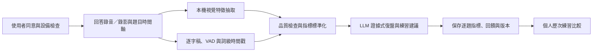

# VivaPrep 多模態表現分析 Agent 設計與調研

> 研究與設計草案｜2026-09-27  
> 範圍：視線／鏡頭朝向、姿勢與動作、口語流暢度、LLM 復盤及練習紀錄。  
> 本文件描述產品與資料架構，所有衡量方式仍須以學生試用和人工標註驗證；不代表已完成實測。

> **實作狀態（2026-09-27）：**已接入選用、僅在瀏覽器記憶體運作的首輪鏡頭試測，以 MediaPipe Face/Pose Landmarker 估計頭部方向代理值、臉部／肩部涵蓋率和上半身位移，依 `turnId`、`speakerId` 及互動階段分段。原始影格與摘要均不傳至 VivaPrep API／資料庫；目前只供本機走查，尚未用人工標註驗證準確度，也不應用作正式回饋或評分。正式保存與研究用途仍須另外實作及取得對應同意。

## 一、建議結論

採用「**程式量測、LLM 解讀、資料庫追蹤**」的分工。影像與音訊的原始指標由可重複執行的程式抽取；LLM 讀取逐字稿、題目、校系評量依據和已計算指標，整理成有證據、有時間點、可執行的教練回饋；系統把指標、回饋、模型／演算法版本和使用者同意狀態一起保存，供使用者查看自己的練習趨勢。

這個設計可以把「我覺得表現比較好了」改成能回看的資料，但**可量化不等於已證明有效**。必須同時保存資料品質與信心，並用人工標註檢查偵測正確率；未經驗證前不合成一個代表面試能力的總分。

## 二、調研發現與產品定位

### 可取得的技術訊號

- Google MediaPipe Tasks Vision 提供 Web／JavaScript 的 Face Landmarker 和 Pose Landmarker。Face Landmarker 可回傳臉部 landmarks、blendshape 與 transformation matrix；Pose Landmarker 可回傳身體 landmarks 及世界座標。這足以支援瀏覽器端的頭部方向、臉部在畫面中的涵蓋情況、上半身姿勢變化等基礎特徵。官方也指出逐影格同步推論可能阻塞 UI，建議把推論放進 Web Worker。[Face Landmarker Web 指引](https://developers.google.com/edge/mediapipe/solutions/vision/face_landmarker/web_js) · [Pose Landmarker Web 指引](https://developers.google.com/edge/mediapipe/solutions/vision/pose_landmarker/web_js)
- Face Landmarker 的眼睛方向 blendshape 是模型輸出的一種係數，但官方將 blendshape 描述為臉部表情／虛擬角色用途，並沒有提供「眼睛注視鏡頭比例」的校準保證。因此初版適合稱為「鏡頭朝向／頭部方向」等可觀察代理指標；真正眼球注視估計應列為後續研究與個人校準功能，不應把 blendshape 直接宣稱為精準眼動儀。[Face Landmarker 輸出說明](https://developers.google.com/edge/mediapipe/solutions/vision/face_landmarker/web_js)
- Google Cloud Speech-to-Text 可回傳字詞時間戳；官方指出 V2 的時間戳屬 experimental，準確度可能變動。它可協助逐字稿定位，但長停頓最好同時用音訊 VAD（語音活動偵測）計算，避免只依賴 ASR 的詞界時間。[V2 字詞時間戳 API 說明](https://docs.cloud.google.com/speech-to-text/docs/reference/rpc/google.cloud.speech.v2) · [V2 時間戳程式範例](https://docs.cloud.google.com/speech-to-text/docs/samples/speech-transcribe-word-time-offsets-v2)

### 競品核對

- Big Interview 官方列出的 AI 回饋包括肢體語言、眼神、語速和贅詞；Yoodli 說明可透過相機回饋肢體語言與畫面置中。因此，三類原始指標本身並非全球首創。[Big Interview](https://www.biginterview.com/platform/practice-with-interview-simulator) · [Yoodli 練習說明](https://support.yoodli.ai/en/articles/9550465-practice-with-yoodli)
- MIND 的升學練習頁面公開展示內容、表達與回答長度等回饋；MIND 的企業 AI 面試頁面另描述語氣、停頓與非語言訊號分析。後者是企業招募產品，不應直接等同其升學產品已提供完全相同的學生視覺分析。[MIND 升學面試](https://education.mind-interview.com/zh-TW/education-practice/) · [MIND 企業 AI 面試](https://education.mind-interview.com/zh-TW/ai-interview/)
- 因此，VivaPrep 可以把多模態回饋列為產品特點；較有辨識度的差異應來自它如何服務台灣升學面試、將個人備審追問和校系規準放進同一場復盤，並以有品質標記的個人歷次紀錄支持重練。以上競品比較以公開產品頁的供應商描述為準，沒有把宣稱視為獨立效能驗證。

## 三、Agent 定位與資料流程

建議命名為「**多模態表現復盤 Agent**」。它是模擬面試結束後執行的分析角色，與場中負責提問的考官 Agent 分開。除非產品未來要做即時提示，分析 Agent 不應在學生回答途中插話。



| 元件 | 職責 | 不負責的事 |
|---|---|---|
| 場次紀錄器 | 記錄問題、回答起訖、角色、音訊／影像時間軸和同意狀態。 | 不判定回答好壞。 |
| 本機視覺分析器 | 從視訊影格抽出頭部方向、臉部可見度、姿勢／動作的描述性統計；用 Web Worker 執行，避免阻塞介面。 | 不推斷誠實、自信、人格、興趣或錄取機率。 |
| 語音與文字分析器 | 取得逐字稿與時間資訊；以 VAD／時間戳計算語速、停頓、回應延遲與經核對的填充詞。 | 不單靠 ASR 轉錄結果判定內容品質。 |
| 品質閘門／指標計算器 | 計算數值、涵蓋率、信心、有效樣本數；資料不足時標記「無法判讀」。 | 不把缺失資料當 0 分，也不以單一分數排序學生。 |
| LLM 復盤器 | 結合答案文字、問題、評量規準和程式指標，產生引用證據的解釋與下一個練習。 | 不重算視覺數值、不猜測未提供的事件、不產生人格診斷。 |
| 練習紀錄器 | 保存逐題 metrics、回饋、模型和特徵計算版本、同意及保留設定，提供個人趨勢圖。 | 不把未經同意的練習資料加入共用題庫或模型訓練資料。 |

### 讓偵測結果符合逐題紀錄的對時設計

VivaPrep 前端和後端已經有每題的 `turnId`、`speakerId`／`currentEvent.speakerId` 與提問事件；鏡頭分析應使用這些面試事件作為標籤，不要從畫面猜是哪位教授在說話。鏡頭畫面則以瀏覽器實際呈現的教授肖像區域作 ROI（region of interest），讀取目前 DOM 位置和 `layoutVersion`，不要把三位教授的座位座標寫死。這樣才能對每個時間片記錄「當時是哪位教授、他在畫面哪裡、使用者視線落在哪個區域」。

若三位教授在不同位置同時可見，可對各自肖像 ROI 分別估算；若系統一次只在同一個位置顯示一位教授，鏡頭只能判斷使用者是否大致朝向「目前提問者畫面區域」，無法單靠視線分辨他心裡指向三位教授中的哪一位。這時仍以 `speaker_id` 標記是誰提出問題，但量測名稱要用「朝向目前提問者區域」，不能宣稱辨認了對教授的個別眼神。

每題至少要有下列本機單調時鐘事件：`question_rendered`、`question_audio_started`、`question_audio_ended`、`answer_started`、`answer_ended`。若是文字題，使用 `question_rendered` 至使用者開始回答；語音題以實際音訊播放起訖為準，不用模型生成文字或 API 回應的時間冒充教授實際說話時間。回答開始／結束取錄音事件或 VAD／送出事件，並保存事件來源。每個事件都附 `session_id`、`turn_id`、`speaker_id`、phase 及同一個 `performance.now()` 時基；同時保留伺服器 UTC 時間作跨服務對帳。若瀏覽器事件流或影音時鐘有延遲，記錄估計偏差，不悄悄把誤差當成精準同步。

相機影格可用 `requestVideoFrameCallback()` 的 frame metadata 和單調 callback 時間，再將時間戳送給 MediaPipe `detectForVideo()`。該瀏覽器 API 適用於影片分析與影音同步，但 callback 不保證與攝影機幀率完全同步，因此要記錄實際間隔、漏幀率和處理延遲，並用時間加權而非「影格數／影格總數」計算區段比例。[requestVideoFrameCallback API 說明](https://developer.mozilla.org/en-US/docs/Web/API/HTMLVideoElement/requestVideoFrameCallback) MediaPipe Face／Pose Web 推論是同步呼叫，放在 Web Worker，避免堵住面試介面。[Face Landmarker](https://developers.google.com/edge/mediapipe/solutions/vision/face_landmarker/web_js) · [Pose Landmarker](https://developers.google.com/edge/mediapipe/solutions/vision/pose_landmarker/web_js)

每個可分析區段切成 `question_listening`、`candidate_answer`、`follow_up` 等 phase；分開算「教授提問時朝向該教授的比例」和「回答時朝向該教授／鏡頭的比例」。不要把回答中看開的片刻直接定義成迴避；只有有效資料中反覆出現的長時間區段才可成為描述性回饋，且先對使用者說明量測方法與不確定性。

每個 `turn_id` 至少保留 `question_listening` 和 `candidate_answer` 兩段摘要；若提問是串流音訊，聆聽 phase 必須依實際播放起訖切段。若目前只有文字顯示事件，就把來源明確標成 `question_visible_window`，不可說成教授實際發話期間。後續追問則各自保存 `speaker_id` 與新的 phase/answer id，確保跨題分析不把不同教授或不同階段混在一起。

相機記錄採兩階段保存：原始影格和逐影格 landmarks 留在瀏覽器短暫記憶體中，用完即丟；逐題摘要和必要事件區間只有在對應的個人保存或研究同意有效時才持久化。研究資料不拷貝原始影像、臉部模板或可重建臉部的特徵向量。

## 四、建議量測定義

### 視線與鏡頭朝向

初版把實際眼球注視改成較保守的「鏡頭朝向代理指標」。先檢測臉部可見影格，再依使用者開始前的中性坐姿校準，估算頭部 yaw／pitch 相對於鏡頭方向的偏移。

要回答「教授提問時，受試者有沒有看向那位教授」，輸出分兩個精度等級：`calibrated_screen_zone` 代表通過該裝置／版面的粗略螢幕區域校正，可估算 active interviewer、camera、other on-screen、off-screen；`head_pose_proxy` 只代表頭部方向大致朝向哪個區域，不宣稱眼球真的看著教授。每筆量測必須記錄使用哪個等級，不能把兩種方法合併成同一個「眼神分數」。教授目標區由當時可見的臉部 ROI 定義，三位教授的位置或 UI 版面改變時要更新 layout version。

| 指標 | 初版計算與顯示 | 限制 |
|---|---|---|
| 臉部有效涵蓋率 | 有臉且 landmark 品質達設定門檻的影格數 ÷ 可分析影格數。這是量測品質欄位。 | 光線、遮擋、鏡頭角度會影響；低涵蓋率時不提供朝向結論。 |
| 鏡頭方向比例 | 回答期間，頭部朝向位於個人校準容許區間的有效影格比例。 | 顯示「頭部朝向鏡頭的時間比例」，不稱為「眼神交流分數」或自信分數。 |
| 目前提問者區域比例 | 在教授實際提問／使用者回答期間，落在當時 active interviewer 臉部 ROI 的有效時間 ÷ 該 phase 的總有效時間；另分列鏡頭、其他教授、畫面外與 unknown。 | 「ROI 朝向」不等於眼神接觸；使用時間比例並保留有效秒數、未知比例和校正方法。 |
| 偏轉事件 | 超過待驗證的 yaw／pitch 範圍並持續超過最短時長的片段，附起訖時間。 | 看旁邊可能是思考、看筆記或畫面設置造成，不直接說是錯誤。 |
| 眼球方向估計 | 可研究 Face Landmarker eye-look blendshapes 加個人校準，先以「實驗性」呈現。 | 需要和人工標註比較，眼鏡、眼睛遮擋、低畫質、不同裝置都可能影響。 |

展示名稱建議：「朝向目前提問者畫面區域 68%（有效分析 42 秒；方式：頭部方向估計）」；避免無品質說明的「眼神 62 分」。百分比的分母必須是該 phase 的有效時間，而非整場時間或影格總數。若校正不通過，直接降級成「頭部大致朝向」，不輸出 gaze zone。

### 開始前的攝影機取景校正

你的虛線框提議很適合放在鏡頭測試階段。它主要改善的是**拍攝條件、landmark 可見率和不同場次的可比較性**，不是直接提升模型本身的辨識能力。Face／Pose Landmarker 依影像影格輸出 landmarks 和可見度等資訊；如果臉或肩膀常被裁切，視覺指標就應降信心或不提供。[Face Landmarker Web 指引](https://developers.google.com/edge/mediapipe/solutions/vision/face_landmarker/web_js) · [Pose Landmarker Web 指引](https://developers.google.com/edge/mediapipe/solutions/vision/pose_landmarker/web_js)

建議取景流程：

1. 使用者同意開啟相機後，在即時預覽上顯示可調整比例的**頭部與上半身虛線範圍**；取景範圍以「臉部完整、雙肩可見」為基本條件，不要求所有人身形或座位相同。
2. 如果本場要量測軀幹位移，再提示把上半身與肩部放進畫面；如果只有臉部／頭部指標，使用較小的臉部框。MVP 不為手勢分析強制要求手部入鏡。
3. 用簡短提示協助調整：「臉部太靠近／太遠」、「請把鏡頭提高一些」、「光線不足」、「肩部未入鏡」。提示依臉部尺寸、landmark 可見率、畫面亮度等可觀察品質條件觸發，不對外形或姿勢作評價。
4. 連續數秒達到基本影像品質後顯示「畫面可分析」。再請使用者自然坐好並看向螢幕中的虛擬面試官，記錄短暫的頭部中性位置作為本次基準；不要要求全程直視鏡頭。
5. 面試中若臉／肩部離開分析範圍，只降低該段的有效涵蓋率並在復盤標示資料不足，不把離框本身記成表現扣分。
6. 將畫面設定與校正結果記錄在 session metadata。之後若相機高度、距離或取景明顯不同，提示「與上次拍攝條件不同，趨勢比較可能較不準」。

UI 狀態可用灰色虛線（等待調整）、綠色框線（已達分析條件）、琥珀色提示（可用但某項分析受限）表示。框線應支援放大預覽、鍵盤與讀屏說明、可略過，以及不啟用相機的音訊／逐字稿練習。這能避免把固定姿勢和攝影機設定當成所有學生都必須符合的標準。

### 姿勢與動作

先以 Pose Landmarker 可見的肩、髖、手腕等身體 landmarks 建立描述性統計，將座標依畫面尺寸與肩寬／身體尺度正規化，減少人坐得遠近不同造成的偏差。

| 指標 | 建議呈現 | 產品邊界 |
|---|---|---|
| 上半身姿勢涵蓋率 | 肩部／軀幹 landmark 可用影格比例。 | 有效姿勢影格不足則不給趨勢。 |
| 軀幹位移幅度 | 以肩中點／髖中點的正規化位移，計算每分鐘位移中位數與高分位數。 | 是「位移量」，不是「坐姿好壞」。 |
| 姿勢變化片段 | 偵測明顯偏移片段並附時間戳，讓使用者回看。 | 不判斷焦慮、誠懇或專注。 |
| 手部動作頻率 | 若肩部與手腕長時間可見，可計算每分鐘顯著移動事件。 | 手腕出畫、桌面遮蔽或攝影機只拍臉時標為不可用；初版不辨認「好手勢／壞手勢」。 |

初版建議先做軀幹位移與姿勢涵蓋率；手勢語意分類等資料累積並通過人工檢核後再評估。

### 對話順暢度

對中文使用者，以「字／分鐘」呈現語速；英文再使用詞／分鐘。各語言使用各自的定義，避免直接拿中英文數值互相比較。

| 指標 | 計算方式 | 注意事項 |
|---|---|---|
| 回應延遲 | 模擬考官問題結束到學生開始作答的秒數。 | 若考官語音有串流延遲，使用實際音訊事件時間，不用 LLM 訊息送出時間。 |
| 語速 | 有聲作答時間內的中文字數或英文詞數 ÷ 分鐘。 | 分開計算有效發聲時間與總作答時間；題長不同時才可比較。 |
| 長停頓 | VAD 偵測到的靜音片段數、總靜音秒數；例如先報告 >1 秒與 >2 秒停頓，門檻需經試用校準。 | 問題間停頓、系統延遲與環境噪音要排除。 |
| 填充詞率 | 經人工確認的填充詞數 ÷ 中文字數或有效作答分鐘。 | 「嗯」「然後」「就是」在句中可能有正常語意，須用音訊與上下文核對，不能只靠字串計數。 |
| 語速變異 | 將作答切為短時間窗，顯示語速變化範圍或高低分位數。 | 僅描述變化，不直接標成緊張／自信。 |
| 回答結構與追問承接 | 由 LLM 按校系／題型 rubric 觀察是否有主張、具體例子、結果或是否回應追問，附逐字稿片段。 | 這是語意評估，不是程式量測的客觀數值；應與語速、停頓分欄顯示。 |

短期不建議把所有數據壓成「流暢度 83 分」。單項原始指標和上下文更容易理解，也能避免掩蓋「回答內容清楚但說話較慢」等個別差異。

## 五、LLM 復盤輸入與輸出契約

### 輸入欄位

- `question`: 問題原文、題型、預定時間及所屬校系情境。
- `rubric`: 這一題適用的能力標準和來源；官方資料與模擬設定分開。
- `transcript_segments`: 帶時間戳逐字稿，附 ASR 信心；使用者可修正轉錄錯誤。
- `program_metrics`: 已計算完成的語速、停頓、填充詞、回應延遲、頭部方向和姿勢指標。
- `quality`: 視訊涵蓋率、音訊品質、有效影格數、可用指標和各指標信心。
- `previous_baseline`: 同一使用者在相近題型、相同語言與模式下的歷史中位數；樣本不足則不比較。

LLM 不需要讀取原始影片，也不重新計算 `program_metrics`。視覺特徵在使用者裝置處理，僅將同意提交的摘要指標和必要逐字稿送到後端，能減少原始影音流通範圍。

### 結構化輸出

```json
{
  "answer_id": "ans_001",
  "overall_observation": "回答內容能說明專題目的，結尾的成果描述較簡略。",
  "evidence_items": [
    {
      "kind": "speech_metric",
      "metric_key": "long_pause_count_over_2s",
      "value": 3,
      "unit": "次",
      "time_ranges": [[18.4, 20.7], [43.1, 45.3]],
      "interpretation": "有三段超過兩秒的停頓；其中兩段位於說明成果時。",
      "confidence": "medium"
    }
  ],
  "one_priority_to_practice": "先用一句話說成果，再補充一項量化證據。",
  "drill": {
    "instruction": "用 30 秒重答專題成果，依序說明成果與證據。",
    "success_checks": ["成果先出現", "至少提供一項可核對的證據"]
  },
  "limitations": ["相機朝向只能作為視線方向代理，不代表專注或自信。"]
}
```

輸出校驗規則：所有數值須原樣引用程式結果；每段評語都需連到 `answer_id`、時間範圍或 rubric；如量測品質低，改輸出「本題資料不足，暫不評估」；每題最多給一至兩個優先練習項目。

## 六、量化紀錄與進步追蹤

每場以 `session_id` 分組，每題有獨立 `turn_id`／`answer_id`。為了滿足研究所需的逐題追溯，每筆 camera summary 必須連到**當題教授、互動 phase、版面版本和時間範圍**；同時記錄實際取樣間隔、有效秒數、未知秒數、算法版本、同意收據和品質原因。以下是摘要資料契約草案；數值只示範格式，不代表實測或門檻：

```json
{
  "session_id": "session_2026_001",
  "turn_id": "turn_004",
  "answer_id": "answer_004",
  "active_interviewer_id": "portfolio",
  "phase": "candidate_answer",
  "ui_layout_version": "panel-v2",
  "question_type": "portfolio_followup",
  "language": "zh-TW",
  "capture_mode": "video_optional",
  "time_range": {
    "session_started_at": "2026-09-26T00:00:00Z",
    "start_offset_ms": 18400,
    "end_offset_ms": 81600,
    "timebase": "performance_monotonic"
  },
  "capture": {
    "frame_width": 640,
    "frame_height": 480,
    "inference_target_fps": 10,
    "inference_actual_fps": 8.7,
    "dropped_interval_ratio": 0.08
  },
  "algorithm_versions": {
    "face_landmarker_model": "pinned-model-sha256",
    "pose_landmarker_model": "pinned-model-sha256",
    "gaze_estimator": "head-pose-proxy-v1",
    "feature_schema": "camera-turn-v1"
  },
  "quality": {
    "audio_usable_ratio": 0.96,
    "face_valid_seconds": 52.0,
    "face_total_seconds": 63.2,
    "face_time_coverage": 0.82,
    "eye_visible_time_coverage": 0.71,
    "pose_time_coverage": 0.76,
    "gaze_unknown_time_ratio": 0.24,
    "status": "usable_with_limits",
    "unavailable_reasons": ["eye_occlusion"]
  },
  "metrics": {
    "response_latency_seconds": 1.8,
    "speech_rate_han_chars_per_minute": 228,
    "pause_over_1s_count": 7,
    "pause_over_2s_count": 2,
    "filler_count_per_minute": 4.1,
    "attention_region": {
      "method": "head_pose_proxy",
      "target_region": "active_interviewer_roi",
      "valid_seconds": 47.0,
      "active_interviewer_ratio": 0.68,
      "camera_ratio": 0.12,
      "other_on_screen_ratio": 0.09,
      "off_screen_ratio": 0.11,
      "unknown_ratio": 0.24,
      "longest_off_target_episode_seconds": 3.2
    },
    "upper_body_motion": {
      "normalization": "shoulder_width",
      "valid_seconds": 48.0,
      "normalized_displacement_p50": 0.06,
      "normalized_displacement_p90": 0.14,
      "movement_episode_count": 3
    }
  },
  "events": [
    {"type": "off_target_gaze_estimate", "start_ms": 40200, "end_ms": 43400, "confidence": 0.72}
  },
  "consent": {
    "camera_analysis_receipt_id": "receipt_camera_001",
    "save_personal_metrics_receipt_id": null,
    "research_contribution_receipt_id": null,
    "raw_media_receipt_id": null
  },
  "created_at": "2026-09-26T00:00:00Z"
}
```

資料規則：`active_interviewer_ratio` 的分子是該 ROI 內的有效時間、分母是該 phase 全部可判讀時間；unknown 不得被當成 off-screen，也不能塞 0。`events` 只留帶起訖和信心的描述性區間，不保存逐影格 landmarks、眼睛 crop 或臉部向量。攝影機原始影格預設在瀏覽器即時處理後丟棄；同意只保存個人歷史時，summary 留在私人資料；研究貢獻需另行同意並由受控工作轉成 `research_subject_id` 資料。

上述數值只示範欄位，不是標準或評分門檻。趨勢比較建議遵循：

1. 先比較使用者自己的歷次資料，不與全體學生排名。
2. 盡量選同語言、相近題型、相同回答時限與相同相機設定。
3. 圖表同時顯示樣本數和量測涵蓋率；低品質場次不納入平均。
4. 初期顯示原始值及移動中位數，不聲稱進步是由 VivaPrep 導致。
5. 保留演算法版本；版本更改後不直接把新舊量尺當成同一條趨勢。
6. 原始音訊／影片預設不長期保存；如需要回放，由使用者另行選擇保存期限與刪除。
7. `video_analysis` 只授權本場即時分析，不代表同意保存數值；`save_personal_metrics` 只保存到個人歷史；`contribute_metrics_to_research` 才允許依告知範圍形成跨場次研究資料。三者不可互相推導。

### 縱向研究資料連結（規劃功能）

若使用者另行同意跨場次研究，研究資料限於分析產品所需的結構化欄位：能力／備審主張類別、題型、回答 rubric 結果、鏡頭與音訊衍生指標及品質、量測／提示／建議版本、練習前後變化、申請目標的學年度和階段回報。原始履歷、完整回答、逐字稿、原始影音不複製進研究資料集；如某項分析需要回答語意，須另列欄位用途、資料範圍與同意，再由法務和產品審查。

跨場次以獨立 `research_subject_id` 連結；帳號對照表與研究資料分開存取，撤回同意時停止後續收集並排入移除可識別研究列的工作。每筆研究觀察保存資料來源、收集時間、題型／回饋版本、演算法版本、品質與自述／驗證來源；小樣本或低品質觀察不納入群體分析。

申請結果只用階段事件表示（例如送件、獲邀面試、進入下一階段、offer、接受 offer、未錄取或未知），由使用者自願回報並標示自述來源與時間；不要求上傳通知證明。結果用來了解產品服務過程與練習需求，不作為鏡頭行為的正確標籤，也不訓練個人錄取機率預測器。相關趨勢不能單獨證明某項建議造成錄取或練習改善。

## 七、建議 MVP 範圍

| 優先級 | 實作內容 | 理由 |
|---|---|---|
| P0 | 問答起訖事件、逐字稿時間資訊、中文字／分鐘、停頓數與總時長、填充詞候選、音訊品質。 | 先完成可重複量測，語音指標較容易與逐字稿、錄音片段對照。 |
| P0 | 瀏覽器端 MediaPipe Face/Pose Landmarker；臉部／姿勢涵蓋率、頭部朝向代理指標、軀幹位移摘要。 | 對應視線與肢體需求，同時只報可觀察訊號。以 Web Worker 執行。 |
| P0 | 多模態表現復盤 Agent；取得程式摘要後輸出帶證據的解讀與一個短練習。 | 實現「程式算數據、LLM 教練式解讀」。 |
| P0 | 持久保存逐題指標、品質、版本和同意狀態；提供單人歷次比較。 | 使量化數據能累積並可追溯。 |
| P1 | 手部動作量測、個人眼球視線校準、跨裝置校正、專家 rubrics。 | 需要先驗證 landmarks 品質與使用者接受度。 |
| P1 | 分離的縱向研究資料集、研究代碼連結、介入／建議版本追蹤與自願申請階段回報。 | 驗證哪些練習建議對可觀察的前後變化有幫助；須有獨立 opt-in、足夠樣本和撤回／刪除流程。 |
| 不做 | 自信／誠實／人格推斷、錄取分數預測、通用「面試能力總分」、眼神與手勢的通用好壞標準。 | 容易把不穩定代理訊號包裝成高風險判斷，也無法由目前量測直接支持。 |

## 八、驗證與品質標準

### 技術量測驗證

取樣率先當成待測的工程參數，不是產品品質保證：可從每秒約 10 個推論影格開始，記錄實際影格率／漏幀；它只適合驗證持續一段時間的螢幕區域與上半身位移，不用它聲稱可捕捉短暫掃視或微眼動。研究中的高表現 webcam gaze 管線以約 29.9 FPS 影片離線分析，並需校正；模型推論成本約 1–12 FPS 不等。其最佳模型 fixation 誤差 2.4°，但 4×4 螢幕區域分類只有 65%，較粗的 2 區域分類才有 98%；這是特定校正、設備、模型和實驗任務的結果，不能直接套用成 VivaPrep 的準確率。[Saxena et al., 2024](https://link.springer.com/article/10.3758/s13428-023-02190-6) 另一項 webcam 研究也發現，WebGazer 對短而細微的眼動效果較不準。[Slim et al., 2024](https://pubmed.ncbi.nlm.nih.gov/39654819/)

因此，第一階段的產品目標定為「辨認長時間朝向目前教授／鏡頭／其他畫面區域的大致比例，加上上半身位移」，不承諾像專業眼動儀一樣定位眼球。若 10 FPS 的實測對長區段仍不穩，先降級為頭部方向代理；如果日後要評估短暫掃視，需另做較高影格率和個人校正的研究流程。

1. 建立經相機分析研究用途同意的驗證資料，涵蓋不同鏡頭位置、解析度、光線、眼鏡／反光、側臉、遮擋、自然頭部移動和常見 UI 版面。用於人工標註的短片另外取得保存同意，限制審閱者，驗證完依保存政策刪除；一般練習仍不保存原始影音。
2. 由兩位人工標註者按時間標記「目前教授區／鏡頭區／其他畫面／畫面外／無法判讀」，並標記明顯上半身移動起訖和取景／遮擋品質。對分歧保留 `unknown` 或第三方複核，不強迫形成單一「標準答案」。
3. 在實際三位教授的畫面位置和 speaker 事件上計算 gaze-zone confusion matrix、各區 precision/recall、unknown rate、區段起訖誤差；movement 計算與人工事件重疊率及位移誤差。分別比較 5、10、15（必要時 25–30）FPS 和不同校正方式的準確度、涵蓋率及裝置負載。
4. 比較時按 UI layout、裝置畫質、光線、眼部可見度、姿勢／眼鏡等量測條件分層；不把演算法 confidence 當真實正確率，也不從條件差異推論使用者特質。
5. 依驗證結果訂「可以回饋／只顯示資料不足」門檻。低涵蓋率、時鐘對不上、校正失敗或目標 ROI 不可見時回傳 `unavailable` 原因，不輸出 0% 或「視線迴避」。

### LLM 回饋驗證

- 由升學輔導者／相關領域教師檢查：引用的逐字稿或指標是否存在、是否對應題目規準、建議是否可操作、是否有不當人格推論。
- 記錄每項回饋的接受／修正／拒絕比例與原因。LLM 的流暢文字本身不是回饋正確的證據。
- 以同一能力不同問法進行前後練習，檢查回饋能否促成可觀察的行為改變；早期結果只呈現樣本與趨勢，不宣稱因果或升學成效。

## 九、隱私、包容性與安全邊界

- 啟用相機分析前明確告知用途，可單獨關閉視訊、只用音訊或只看逐字稿；關閉視訊不應阻止完成面試練習。
- 優先在瀏覽器本機抽特徵；伺服器保存派生數值與回饋即可。原始影音預設即時處理後刪除，保存必須另行選擇。
- 本場影像分析、私人歷史保存、跨場次研究貢獻、原始影音回放保存與模型訓練用途各自同意；不同意跨場次分析不影響練習，保存個人影片也不代表同意研究或訓練。
- 跨場次研究只取最小必要的結構化指標、品質、版本、練習介入與選擇性結果；身份對照隔離。自願結果回報標記來源，不當成模型真值或因果證明。
- 不以不看鏡頭、姿勢差異、動作頻率或語速對使用者作為負面人格或能力判定。提供「資料不足／不適用」選項，並容納神經多樣性、身心狀況、文化表達差異及輔具使用。
- 允許使用者修正 ASR 文字或標記某項視覺回饋不適用；保留更正紀錄並使後續趨勢使用已確認資料。
- 練習用數據不向學校或雇主分享，除非使用者明確選擇分享特定報告。

## 十、與 VivaPrep 現有規劃的銜接

此 Agent 是產品流程中的「復盤子系統」，不替代備審追問者、學科考官與動機考官。模擬期間由面試 Agent 保存題目與回答時間軸；結束後依序執行視覺／音訊特徵抽取、品質閘門、LLM 復盤、紀錄入庫與短練習生成。校系 profile 和官方來源提供回答內容 rubric；多模態指標只能支持表達練習，不應左右學科內容評價或錄取推估。

## 參考來源

### Google 技術文件

- [MediaPipe Face Landmarker for Web](https://developers.google.com/edge/mediapipe/solutions/vision/face_landmarker/web_js)
- [MediaPipe Pose Landmarker for Web](https://developers.google.com/edge/mediapipe/solutions/vision/pose_landmarker/web_js)
- [HTMLVideoElement.requestVideoFrameCallback](https://developer.mozilla.org/en-US/docs/Web/API/HTMLVideoElement/requestVideoFrameCallback)
- [Google Cloud Speech-to-Text V2 API：字詞時間戳、信心與識別結果](https://docs.cloud.google.com/speech-to-text/docs/reference/rpc/google.cloud.speech.v2)
- [Google Cloud Speech-to-Text V2 字詞時間戳範例](https://docs.cloud.google.com/speech-to-text/docs/samples/speech-transcribe-word-time-offsets-v2)

### Webcam gaze 研究

- Saxena, S. et al. (2024). [Deep learning models for webcam eye tracking in online experiments](https://link.springer.com/article/10.3758/s13428-023-02190-6). *Behavior Research Methods*, 56, 4836–4849.
- Slim, M. S. et al. (2024). [Webcams as Windows to the Mind? A Direct Comparison Between In-Lab and Web-Based Eye-Tracking Methods](https://pubmed.ncbi.nlm.nih.gov/39654819/).

### 競品官方頁面

- [Big Interview 模擬面試功能](https://www.biginterview.com/platform/practice-with-interview-simulator)
- [Yoodli 練習與相機回饋說明](https://support.yoodli.ai/en/articles/9550465-practice-with-yoodli)
- [MIND Education 升學面試練習](https://education.mind-interview.com/zh-TW/education-practice/)
- [MIND 企業 AI 面試](https://education.mind-interview.com/zh-TW/ai-interview/)
