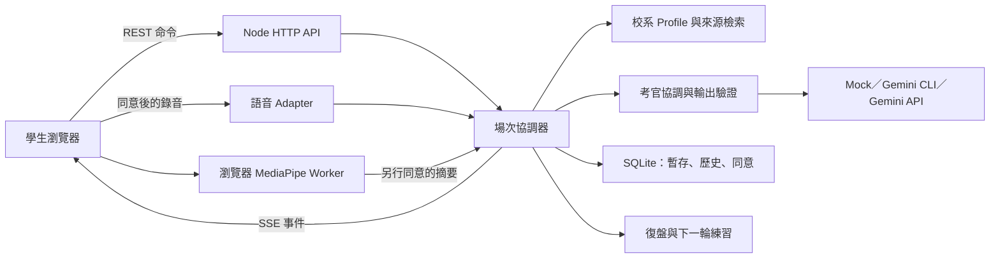

# VivaPrep 專案詳細規劃書

> 文件版本：1.0｜整理日期：2026-10-27（Asia/Taipei）
> 讀者：新加入的組員、產品與技術負責人、準備決賽的簡報及展示人員。
> 用途：完整理解產品、目前程式、驗證證據與下一階段工作；不是已上線服務的承諾。

## 閱讀前先確認：三個不同層次

| 層次 | 本文件採用的基準 | 閱讀與操作方式 |
|---|---|---|
| 遠端 `main` 基線 | 2026-10-27 核對為 `b860673`，約 23 個原型檔案；尚未包含本機完整後端、帳號、語音與驗證腳本。 | 只下載該版本的人，不能依本文件假定已取得全部功能。 |
| 本機工作樹 | 本文件核對的 `server/`、`scripts/`、現行 `src/`、SQLite 與規劃文件；有大量修改及未追蹤檔案。 | 文中「已實作」預設指這個工作樹；不代表已提交、已上傳或另一位組員能直接重現。 |
| 後續規劃 | 尚未接入或缺乏實測的功能，例如 Live、Drive、正式雲端部署與外部成效驗證。 | 必須通過各節驗收後才能改列完成；架構圖、資料表與 adapter 存在都不足以代表完成。 |

本次文件提交不等同於同步本機程式。組員開始實作前，先確認拿到哪個 commit、哪些本機檔案已正式交接，並建立可重現的工作版本。
現有較早的 README、初步規劃與 UI 規格保留了歷史方向；若文字互相衝突，先看本文件的狀態日期，再以對應工作樹程式及可重現證據判定。
所有路徑均相對於 VivaPrep repository 根目錄；標示「本機」的檔案未必已出現在遠端，因此僅列路徑，不製造失效的檔案連結。

## 目錄

1. [產品動機、價值與邊界](#product)
2. [使用者、情境與成功指標](#users)
3. [完整旅程與一場面試實例](#journey)
4. [功能現況與完成定義](#status)
5. [整體架構與程式導覽](#architecture)
6. [考官、協調器與 Gemini Provider](#agents)
7. [備審資料庫與 PDF 主張流程](#portfolio)
8. [校系來源、RAG 與官方資料治理](#sources)
9. [回合制語音與未來 Live](#speech)
10. [MediaPipe、多模態與量測界線](#camera)
11. [前端、2D 場景與保留的 3D 資產](#frontend)
12. [REST、SSE 與場次狀態](#api)
13. [SQLite 與資料模型](#database)
14. [同意、保存、匿名分享與帳號安全](#privacy)
15. [安裝、設定、啟動與排錯](#run)
16. [驗證證據與下一輪評估](#validation)
17. [競品、技術取捨與發展方向](#tradeoffs)
18. [兩人工作分工、階段與驗收](#delivery)
19. [風險、決賽敘事與待確認決策](#risks)
20. [詞彙、文件索引與外部參考](#references)

<a id="product"></a>
## 1. 產品動機、價值與邊界

VivaPrep 是面向台灣大學個人申請第二階段的 AI 模擬面試與復盤系統。
它把「官方校系指引、學生自己確認的備審主張、回答承接追問、引用證據的復盤、再練習」接成一個準備流程。
核心承諾是：讓學生把自己寫下的經驗說清楚，能回答有根據的追問，並知道下一次該怎麼練。

### 1.1 為什麼需要這個產品

- 官方資料能說明程序及觀察重點，通常不能直接變成一場個人化問答。
- 心得散落且年份、校系、管道不同；把單一心得當固定題型，容易誤導學生。
- 備審中的演算法、專題、活動與個人貢獻，都可能成為追問起點；只背通用題不足以準備。
- 真人互練有價值，但考官時間、可得性與回饋一致性受限。
- 通用聊天能出題，仍需要來源管理、場次節奏、錯誤處理及回饋到重練的產品流程。

### 1.2 我們希望提供的價值

| 價值 | 產品如何做到 | 應展示的證據 |
|---|---|---|
| 可追溯 | 校系資料帶年份、管道與來源；備審主張附檔名、頁碼、摘錄。 | 從一題回查來源與學生確認的主張。 |
| 可追問 | 考官承接學生上一個回答，釐清方法、驗證、貢獻與取捨。 | 連續兩至三回合，而非獨立題庫輪播。 |
| 可重練 | 復盤提供回答證據、少量優先建議與短練習題。 | 原回答、建議、第二次回答能並列檢視。 |
| 可選擇 | 訪客可用，文字模式可完成；語音、鏡頭、保存與分享各自決定。 | 不開相機、不分享心得仍能走完流程。 |

### 1.3 明確不做的事

不預測錄取、不保證命中考題、不代表真實教授或招生委員會，不以 AI 回饋取代學校正式評分。
三位考官是功能角色，不仿冒真人姓名、聲音與人格，也不表示正式面試一定有三位委員。
鏡頭訊號不判斷自信、誠實、焦慮、人格或能力；心得核准只代表符合分享與檢索政策，不代表內容已被官方證實。
私人備審、練習回答與影音不因使用服務就自動變成共用題庫或模型訓練資料。

<a id="users"></a>
## 2. 使用者、情境與成功指標

### 2.1 主要與次要使用者

- 主要：準備個人申請面試的高中生；先聚焦資訊工程、資訊電機等能以具體作品追問的情境。
- 次要：升學輔導老師、導師與協助互練的人；目前不是班級管理或教師評分平台。
- 使用情境：面試前反覆練習、從備審找可能被追問的主張、練後整理一兩個可改善項目。
- 後續可延伸：研究所口試、轉學考、實習與求職；每一領域都需要新的來源、規準與驗證。

### 2.2 成功指標分三層

| 層次 | 指標 | 現況與判讀 |
|---|---|---|
| 系統可用 | 完成率、解析失敗率、回合耗時、重試率、資料刪除與恢復是否正確。 | 已有部分本機腳本與單場量測，可擴充為固定驗收集。 |
| 回饋品質 | 追問切題度、回饋可執行性、引文正確性、官方／心得混用率。 | 引文有程式檢查；整體品質仍需人工評閱與對照。 |
| 教育效益 | 第二次回答是否更能說清楚方法與證據、學生是否知道下一步。 | 尚無足夠外部試用與對照證據，不宣稱已提升錄取或能力。 |

「12 支檢查通過」是工程可靠性的一部分，不等於學生學習成效已驗證。
「等待時間下降」需固定模型、裝置、網路、輸入與量測區間，不能把不同條件的數字直接比較。
近程優先建立可用且可信的單一情境，再擴大校系；來源品質與實際回饋價值優先於資料筆數。

<a id="journey"></a>
## 3. 完整旅程與一場面試實例

### 3.1 使用者旅程

1. 選學年度、校系及招生管道，閱讀官方資訊、未知事項與最後核對日。
2. 進入資料使用設定，選擇是否允許模型、PDF、語音、鏡頭及保存處理。
3. 在備審資料庫選取 PDF；選檔本身不會立即傳送，按整理後才處理。
4. 核對候選主張、頁碼與摘錄，修改或移除不準確內容；也可直接手動新增。
5. 在準備頁勾選本場使用的文件與主張，設定考官、5／10／15／20 分鐘及文字或語音。
6. 測試麥克風與選用鏡頭；設備測試不錄製或傳送聲音。
7. 開始場次，依問題回答；可要求改問、換題、暫停收音或改文字。
8. 最後一題後致謝收尾；等待中的模型與轉錄不占有效練習倒數。
9. 看復盤中的原話證據、優先改善與重練題，回到下一輪練習。
10. 登入且同意保存者可回看私人歷史；真實面試心得需另外自行撰寫、同意與送審。

### 3.2 一場合成案例：校園借閱系統專題

此例用來說明流程，不是真實考生個資，也不是官方考題。
學生確認的主張是「我用 Python 完成校園借閱系統的搜尋功能」，出處為示範文件第 2 頁。
考官先問親自實作哪些搜尋機制；學生說用關鍵字找書並建立測試資料。
下一題承接「測試資料」，要求舉出邊界案例；學生說先把大小寫統一，再處理空字串與查無結果。
考官可再問修正前後如何驗證，或時間接近結束時改問下一步想學的資料結構。
復盤引用「先把大小寫統一」這句話，肯定有辨識輸入條件，再建議補充測試案例與結果。
重練任務是用 30 秒依「問題→修改→驗證」重答一次，檢核是否至少提供一個具體輸入與結果。
如果學生沒有回答某題，應標示資料不足，不能生成「不熟悉該技術」的能力結論。

<a id="status"></a>
## 4. 功能現況與完成定義

狀態 A：本機已接入，並有腳本或既有流程紀錄；仍需在交接機重新跑。
狀態 B：程式路徑已有，缺乏足夠真實服務、實體設備或代表樣本驗證。
狀態 C：後續規劃，尚未接入現行使用流程。下表不表示遠端 `main` 已包含對應檔案。

| 功能 | 狀態 | 目前證據或限制 |
|---|---|---|
| 選校系、設定、文字面試、復盤、再練入口 | A | 本機前後端與流程檢查；不等於教育成效。 |
| Gemini CLI 開場、追問、停頓改問與復盤 | A | 2026-09-28／29 合成輸入及留存 JSON。 |
| Gemini API Provider、結構化輸出 | B | 已有直接 API 程式；需使用合法設定在目標環境重驗。 |
| API 原生 inline PDF | B | `generateDocument()` 路徑存在；圖表／掃描 PDF 品質尚待對照。 |
| CLI PDF.js 文字抽取與分段整理 | A | 多文件、摘錄核對、格式失敗與重試檢查。 |
| 備審資料庫與選擇性 IndexedDB 保存 | A | 白名單保存及輸入流程檢查；仍需跨瀏覽器走查。 |
| 本機 Whisper／Windows 回合制語音 | A | 固定合成錄音實測；未形成真人麥克風準確率統計。 |
| Gemini Transcribe／TTS adapter | B | 已有程式；不將本機語音結果算成 Gemini 語音實測。 |
| MediaPipe Worker 與摘要復盤／保存 | B | 接線與資料契約存在；無人工標註效度、跨裝置證據。 |
| SQLite v3、帳號、私人歷史、審核／撤回 | A | 本機已接線；正式資安、復原與多使用者壓測待做。 |
| 2D 面試室與考官動作切換 | A | 現行 `src/app.js` 使用去背 pose sheets。 |
| 正式 3D 化身與動畫品質 | C | 有舊程式、GLB 與 Blender 審查資產，現行房間不載入。 |
| Gemini Live、Drive Picker | C | 尚未有正式串流、OAuth、選檔匯入路徑。 |
| Cloud Run、正式資料庫、多實例部署 | C | 本機 SQLite 不代表 Cloud／Firestore／PostgreSQL 已接入。 |
| OIDC、研究資料集、申請階段回報、原始影音回放 | C | 僅規劃，不宣稱已蒐集或支援。 |
| 班級教師後台、外部使用者成效、全台題庫 | C | 需需求研究、同意／權限與獨立驗證。 |

一項功能完成需同時有：可重現版本、設定、有效資料流、錯誤與權限行為、適合的測試、交接說明。
狀態變更時保留日期、證據及限制；不要只把「規劃」二字刪掉。

<a id="architecture"></a>
## 5. 整體架構與程式導覽



這張圖描述本機工作樹；圖中 Provider 與語音服務依設定選用，不表示全部同時啟用。
前端負責顯示、輸入、播放、有效時間與本機視覺；後端負責所有權、狀態、模型、來源與資料保存。
LLM 負責產生問題及語意回饋；程式控制誰發言、是否接受輸出、何時收尾與可保存哪些資料。

| 本機路徑 | 主要職責 |
|---|---|
| `server.mjs` | 組裝服務、資料庫、Provider、清理程序及靜態檔案入口。 |
| `server/http-api.js`、`server/config.js` | HTTP 契約、驗證、環境設定與限制。 |
| `server/interview-orchestrator.js`、`server/session-store.js` | 場次狀態、回合、事件、恢復、結束與復盤。 |
| `server/agent-service.js`、`server/agent-provider.js` | prompt、schema、引文驗證、PDF 與模型抽象。 |
| `server/panel-coordinator.js`、`server/opening-planner.js` | 考官選擇、重複抑制、開場角度。 |
| `server/cli-conversation.js`、`server/interview-guide.js` | CLI 串流隔離與受信任提問流程。 |
| `server/profiles.js`、`server/source-retriever.js` | 校系設定、來源標籤與有限來源檢索。 |
| `server/speech-adapter.js`、`server/local-whisper.js` | 雲端／本機 STT、TTS 與程序生命週期。 |
| `server/database.js`、`server/crypto-utils.js` | schema migration、應用層加密與雜湊。 |
| `server/auth-service.js`、`server/interview-history-repository.js` | 帳號、權限、私人歷史、匯出與清除。 |
| `server/report-repository.js`、`server/email-delivery.js` | 心得治理與郵件 adapter。 |
| `src/app.js`、`src/styles.css` | 現行頁面、2D 考官、語音控制及前端流程。 |
| `src/portfolio-library.js`、`src/interview-timing.js` | 本機備審庫與面試時間輔助。 |
| `src/camera-analysis.js`、`src/camera-analysis-worker.js` | 鏡頭採樣、分段、品質與衍生摘要。 |
| `scripts/check-*.mjs` | 隔離檢查、合成輸入、真實服務量測入口。 |

<a id="agents"></a>
## 6. 考官、協調器與 Gemini Provider

### 6.1 三位場中考官與場後復盤

| 後端角色 | 問題範圍 | 前端識別 |
|---|---|---|
| `portfolio` | 備審經驗、作品、貢獻、方法、困難及成果。 | `portfolio` |
| `technical` | 學生提到的資工概念、推理、驗證與技術取捨。 | `technical` |
| `motivation` | 選系動機、學習策略、反思與下一步。 | 沿用 `logic`，屬相容性映射。 |
| `review` | 面試後分析逐字稿、觀察面向與經同意的摘要。 | 復盤頁，不參與場中搶答。 |

早期文件曾描述三位同時各自分析再選題；目前低延遲場中路徑先由程式選一位相關考官，只生成一個短問題。
完整多面向觀察移到場後；不要把現場未產生的兩份評語補寫成既有成果。
角色選擇、輪替、近期提問重點、相似問題排除與結束時機由程式控制；模型不是狀態機。

### 6.2 Prompt 與輸出契約

輸入依序包含全域規則、校系已知／未知資訊、角色任務、學生確認主張、來源片段與最近對話／時間。
學生答案、PDF 和心得是待處理資料，不能改變系統規則或授予工具權限。
場中精簡輸出為 `candidateQuestion`、`questionFocus`、`dialogueAction`、`sourceRefs`。
後端檢查型別、長度、來源 allowlist、問題重複及可用內容，無效則限制重試或顯示錯誤。
復盤包含整體摘要、優點、改善優先項目、不同觀察面向、練習題、引文、來源與資料限制。
引文必須能在對應回合問題或回答中找到；這能檢查引用存在，仍不能保證語意評價正確。
完整逐字稿依容量分段，每段最多六回合，必要時再統整；統整後引文再次核對。

### 6.3 三種 Provider 的差異

| 模式 | 用途 | 資料及可靠性界線 |
|---|---|---|
| `mock` | 無外部模型的介面與流程檢視。 | 明確標為本機示範，不是真 Gemini 結果。 |
| `cli` | 後端啟動已登入的 Antigravity CLI 呼叫 Gemini。 | 每場獨立 conversation、暫存工作目錄、限制 timeout；依 CLI 帳號與可用模型運作。 |
| `gemini-api`／`gemini` | 後端直接呼叫 Gemini Interactions API。 | 金鑰只在服務端；有文字及 inline PDF 路徑，仍需目標環境實測。 |

CLI 場中使用精簡模型設定並重用該場連線；解析只接受當回合新輸出，防止過期 `structured_output` 當成新題。
場次結束或刪除會釋放 CLI；批次與場次各自隔離。找不到 CLI、模型不可用或呼叫失敗時，不靜默退回 mock。
API Provider 設 `store: false`，這是請求參數，不能延伸成供應商完全不留資料的法律或營運承諾。
目前程式的模型預設值是設定快照；部署時應核對帳號實際可用模型、API 版本、配額及資料處理條件。

<a id="portfolio"></a>
## 7. 備審資料庫與 PDF 主張流程

備審不是直接丟入所有 prompt 的長文件。先轉為學生能檢查、修正、勾選的主張，面試只帶必要欄位。
候選主張包括文字、類型、信心、文件 ID、檔名、頁碼與短摘錄；信心不是能力分數。

### 7.1 兩條解析路徑

| 階段 | CLI 路徑 | Gemini API 路徑 |
|---|---|---|
| 進入後端 | 同意後傳 PDF，僅在記憶體處理。 | 同意後傳 PDF，僅在記憶體處理。 |
| 模型輸入 | PDF.js 抽取頁面文字，再分段送 CLI；原 PDF 不送給模型。 | 以 inline document 將原 PDF 送 Gemini；目前不使用 PDF Files API。 |
| 能力範圍 | 可擷取文字；不做掃描 OCR、圖表或版面視覺理解。 | 可保留原生 PDF 圖文理解路徑；品質必須以樣本驗證。 |
| 產出檢查 | 摘錄需存在於當文件、當段的指定頁面文字。 | schema 與欄位檢查；原生路徑不具有同樣的 PDF.js 全文逐段比對保證。 |
| 人工步驟 | 學生回查 PDF、確認或修改後才進面試。 | 同樣需要學生核對，頁碼與摘錄不是已查證證明。 |

### 7.2 本機限制與保存

- UI 最多五份，每份 8 MB，合計 24 MB；依序解析，失敗時只重試未完成文件。
- CLI 文字抽取上限為 100 頁、84,000 字元；分段約 12,000 字元，避免一次提交整份長文。
- 每份最多八則候選主張；面試最多使用 40 則已確認主張。
- CLI 解析回覆上限 45 秒；格式或全部摘錄驗證失敗時，該段最多再試一次。
- 回傳 `elapsedMs`、`chunkCount`、`retries`、`parserVersion`，頁面顯示每份耗時。
- 完成後釋放原檔參照與整理批次；服務端不把原始 PDF 寫入資料庫。
- 可另外允許 IndexedDB 保存文件 metadata、人工確認後主張及短摘錄；不保存 PDF、登入憑證或面試回答。
- 訪客與各帳號使用不同保存範圍；移除文件會移除其主張，關閉保存會清除本機資料。
- SHA-256 與 parser version 用於瀏覽器端重複檔案判斷，不是外部驗證或公開文件識別服務。

後續應以相同的文字、圖表、掃描及特殊字型樣本比較兩路徑，記錄主張支撐率、頁碼正確性、延遲與成本。
目前不可宣稱所有 PDF 都能正確解析；密碼保護、損毀、無文字與內容過大需明確提示替代方式。

<a id="sources"></a>
## 8. 校系來源、RAG 與官方資料治理

### 8.1 RAG 現況

本機是結構化 profile 加關鍵詞／標籤排序，不是向量資料庫，也沒有模型微調。
來源檢索先以校系、學年度與招生管道過濾，官方來源優先，再補同條件的核准心得及同管道舊年度心得。
目前 `retrieveSources()` 預設最多八筆，不自動從網路搜尋，不把 APCS 回退成一般申請。
設計文件提過跨校題型回退；目前程式的來源選擇更保守，不應把跨校擴充當成已實作。
生成題不是第一手經驗，不可回寫後再當成官方來源或真實考古題使用。

### 8.2 本機 profile 快照

| Profile | 狀態 | 已保存來源與未知 |
|---|---|---|
| `fcu-general` | 115 學年度官方資料情境。 | 2026-09-26 核對；一關、5 分鐘與觀察重點；委員人數未載明。 |
| `fcu-apcs` | 115 學年度官方資料情境。 | 2026-09-29 補入來源；與一般組分開；不主張固定自介及題序。 |
| `ncu-eecs` | 一般練習 stub。 | 尚未載入官方來源，不能當成已還原該校正式規則。 |
| 自訂情境 | 單場一般模擬。 | 使用者輸入背景，不保存為已查證的官方校系資料。 |

較早文件「僅一個官方 profile」已落後於工作樹；以上依 `server/profiles.js` 列出，不表示已重查下一年度。
正式 5 分鐘與 UI 的 10／15／20 分鐘延伸練習應分開標示；三位模擬考官不推定官方委員人數。

### 8.3 資料來源與後續治理

目前校系來源是學校公開招生指引；公開可讀不自動等於採開放授權的開放資料集。
來源記錄保留 URL、標題、摘要、必要摘錄、學年度、招生管道、來源類型、最後核對日與版本。
新增來源時先查使用條件，優先保存必要摘要與引用，不整篇複製論壇或教材；圖像另需確認素材權利。
官方規則、官方評量重點、第一手心得、跨校題型與模型生成練習，各用不同類型及信心標籤。
核准心得的檢索權限來自有效分享同意與人工審核，內容仍為自述；樣本少時不稱「常見」或「多數」。
來源過期、衝突或下一學年度變更時保留版本差異，停用錯誤來源，評估既有題目與報告是否需提示。
未來擴資料庫先建立來源登錄、審核人、更新週期、撤回與快取失效，再討論向量索引或自動蒐集。
若引入政府開放資料，逐資料集記錄提供機關、授權、更新頻率及必要標示；目前沒有已完成的大型政府題庫串接。

<a id="speech"></a>
## 9. 回合制語音與未來 Live

現行語音是「錄音→STT→文字考官→TTS」，一回合一回合執行；SSE 串流事件不等於即時音訊 Live。
問題音訊實際播放結束才開始收音與回答等待；未允許自動播放時提供手動播放或字幕。
偵測持續聲音約 0.18 秒後視為開口，停頓約 2.5 秒自動送出，也可手動送出或暫停。
這些門檻是工程設定，不是學生說話品質標準；實體麥克風、噪音與輔助需求仍需測試。
約 8 秒未作答先降低難度改問，再等約 12 秒仍無回答才換話題；沒收到聲音不推斷能力不足。
收音、辨識與播放綁定 `turnId`、事件序號；舊題結果、結束後晚到的模型題目不得覆蓋新狀態。

| 語音模式 | STT／TTS | 重要差異 |
|---|---|---|
| `off` | 不提供語音服務。 | 仍可文字面試。 |
| `windows-sapi` | Windows 本機辨識／合成。 | 不需 Gemini key；平台與繁中語音套件影響結果。 |
| `whisper-local` | faster-whisper small、CPU int8；Windows 合成。 | 本機常駐模型、記憶體錄音管線，需下載及環境準備。 |
| `gemini` | Gemini Transcribe 與 TTS adapter。 | 需 API key；音訊上傳暫存後要求刪除；仍為回合制。 |

Whisper 使用 VAD、繁中轉換與技術詞提示協助辨識，不替學生生成回答；轉錄仍可能有同音字錯誤。
有效練習時間包含考官朗讀、學生思考與回答；模型等待、轉錄與合成準備暫停倒數。
最後 15% 時間（上限 90 秒）收斂為短題，剩 20 秒不再開新題；最後答案保存後致謝，再進復盤。
未來 Live 預期增加串流與打斷；必須重新設計取消、對時、同意、重連及文字降級，不能只替換一個 API 名稱。
Google 官方 Live 文件列有低延遲語音、打斷與轉錄能力；本專案尚未接入，詞級時間戳等細節應於選型時重核。[Gemini Live 官方說明](https://ai.google.dev/gemini-api/docs/live-api)

<a id="camera"></a>
## 10. MediaPipe、多模態與量測界線

本機鏡頭分析分開要求「開啟本機分析」與「把衍生摘要提供復盤」；只有對應同意成立才送摘要。
Face／Pose Landmarker 在 Web Worker 處理，避免視覺推論占住介面；原始影格及 landmarks 不傳至後端。
視覺套件由本機服務提供，但模型路徑使用 Google Storage；首次載入通常需要網路，不能宣稱整個鏡頭流程完全離線。
Worker 約以 10 FPS 為目標，實際速度依裝置、模型載入與瀏覽器而異，不能當作性能保證。
以題目、考官、聆聽／回答 phase 分段；前端播放與輸入事件提供時間標籤。

| 現行摘要 | 可描述什麼 | 不能推論什麼 |
|---|---|---|
| 臉部／肩部涵蓋率 | 可分析資料與取景品質。 | 沒入鏡就代表不認真或低分。 |
| 頭部方向代理值／區域比例 | 相對校準基準的大致頭部偏轉。 | 精確眼球視線、看著哪位教授、自信或誠實。 |
| 肩部中心正規化位移 | 上半身位置變化。 | 焦慮、專注、姿態好壞或人格。 |
| 有效秒數、樣本數與品質 | 判斷是否足夠呈現數值。 | 把缺失資料當零分。 |

設備頁有頭部與上半身建議框；光線、距離自動提示與框線效度仍待實作／驗證。
`camera-trial-v1` 摘要由後端限制型別與範圍，復盤只收到對應回合的資料；保存私人歷史需另行同意。
現有歷史可並列相同校系摘要，不表示已證明能力進步；量測版本、裝置與題型不同時不可直接排名。
語速、填充詞、詞級時間戳、精準回應延遲、眼球注視、手勢語意與自動影音回放都不在已驗證能力內。
下一階段先用同意的合成／團隊走查樣本標註明顯轉頭與位移，記錄未知率、FPS、漏幀與誤差，再決定是否擴大。
官方 Face Landmarker 提供 landmarks、blendshape 與矩陣等輸出；產品上的能力解讀仍須自行驗證。[Face Landmarker Web 指引](https://developers.google.com/edge/mediapipe/solutions/vision/face_landmarker/web_js)

<a id="frontend"></a>
## 11. 前端、2D 場景與保留的 3D 資產

現行前端以原生 JavaScript／CSS 組成，面試室使用平面背景與三位去背考官 pose sheets。
`src/app.js` 依 speaking、listening、reading_notes、considering 等事件切換動作、字幕、狀態與音訊。
此作法先確保文字與語音互動、考官辨識、低性能裝置相容；角色視覺不是教育效益的主要證據。
`src/interview-scene.js` 仍有 Three.js、GLTFLoader、程序化房間及動畫 clip 定義，但不是現行房間的載入入口。
`public/assets/avatars/` 的 GLB 與 `tools/3d/` 的 Blender、預覽、幾何驗證檔為保留資產，不能宣稱已正式使用。
若重啟 3D，需先確認人物權利、坐姿、比例、桌椅接觸、動作 parity、GPU 負載與無 WebGL 降級。
短期 UI 驗收重點是流程可讀、字幕可操作、錯誤可恢復、鍵盤可用，以及麥克風／鏡頭狀態清楚。
文字模式與停用鏡頭是完整入口；不得因拒絕選用媒體就阻擋練習或生成負面評語。

<a id="api"></a>
## 12. REST、SSE 與場次狀態

REST 送出命令，SSE 送回事件；每個 API 先做擁有權及必要的 CSRF／權限驗證。
下表依本機 `server/http-api.js`；是團隊契約導覽，不是遠端基線已提供的 API。

| 方法與路徑 | 用途與關鍵條件 |
|---|---|
| `GET /api/health` | 模型、語音及服務狀態；先確認是否 mock。 |
| `GET /api/profiles`、`GET /api/profiles/:id` | 來源、已知規則及未知項目。 |
| `POST /api/profiles/custom` | 建立一般模擬情境，不升格官方資料。 |
| `POST /api/portfolio/parse`、`POST /api/portfolio/release` | 同意後解析單份 PDF；釋放隔離整理批次。 |
| `POST /api/sessions`、`GET /api/sessions/:id` | 建立場次、讀取本人場次與 timings。 |
| `GET /api/sessions/:id/events` | SSE；用 `Last-Event-ID` 或 `after` 接續序號。 |
| `GET /api/sessions/:id/events/:seq/audio` | 讀取該場問題音訊，private／no-store。 |
| `POST /api/sessions/:id/answers`、`/audio-answers` | 文字或音訊作答，回合與事件序號防止過期套用。 |
| `PATCH /api/sessions/:id/settings` | 字幕與輸入模式；啟用語音仍須有效同意及服務。 |
| `POST /api/sessions/:id/nudge`、`/activity`、`/progress` | 改問／換題、作答活動及有效練習時間。 |
| `POST /api/sessions/:id/ending`、`/close`、`/finish` | 停止新題、致謝、開始復盤；順序由流程控制。 |
| `GET /api/sessions/:id/review`、`POST /api/sessions/:id/review/retry` | 復盤狀態及可重試錯誤。 |
| `DELETE /api/sessions/:id` | 刪除暫存場次、釋放程序與音訊。 |
| `/api/auth/*`、`/api/account/*` | 登入、驗證、密碼、MFA、私人歷史、匯出與刪除。 |
| `/api/reports/*`、`/api/admin/*`、`/api/privacy/requests` | 分享政策／預覽／送審／撤回、管理及個資請求。 |

SSE 以 `seq` 遞增並可重播，約每 20 秒 heartbeat；前端不能把重連事件重複當成新問題。
主要事件包括 `session.ready`、`interview.event`、`answer.received`、`interview.audio.ready`、`interview.closing`、`session.ended`、`review.ready`、`review.failed` 與 `error`。
場次主要經 active／closing／reviewing／completed 或 review_failed；UI 不應自行假設模型請求完成就是面試結束。
場中音訊準備可晚於問題事件；晚到音訊需確認 turn 與 eventSeq，已關閉／換題就丟棄。
模型不回傳完整內部推理給前端；事件只包含顯示所需的問題、角色、動作、來源與狀態。

<a id="database"></a>
## 13. SQLite 與資料模型

目前資料庫為 Node 內建 `node:sqlite`，schema version 3，預設 `.data/vivaprep.sqlite`。
設定 WAL、foreign keys、busy timeout 與 migration；啟動時拒絕高於程式支援版本的資料庫。
場次 snapshot 配合正規化 turns／history／consent 等表，不是所有功能只塞一份 JSON。

| 資料領域 | 主要表 | 關係與說明 |
|---|---|---|
| 帳號 | `users`、`user_contacts`、`password_credentials`、`user_roles` | 使用者、加密聯絡資料、密碼雜湊與角色。 |
| 認證 | `auth_sessions`、`auth_action_tokens`、`user_mfa`、`user_mfa_recovery_codes` | opaque session、單次 token、TOTP 與復原碼。 |
| 同意 | `consent_policy_versions`、`consent_receipts` | 用途、政策版本／hash、動作與時間；分享收據不連帳號。 |
| 暫存面試 | `interview_sessions`、`interview_turns` | 擁有者或 guest hash、場次 payload 與逐題紀錄。 |
| 私人歷史 | `interview_history`、`interview_history_turns`、`interview_reviews` | 登入者 opt-in 保存的完成場次、回答與復盤。 |
| 分享 | `community_reports`、`report_revisions`、`report_withdrawal_credentials` | 分享範圍、版本、撤回雜湊，不含作者 user／session FK。 |
| 治理 | `report_moderation_events`、`knowledge_sources` | 審核事件與目前可檢索來源。 |
| 維運 | `privacy_requests`、`security_audit_events`、`integration_outbox` | 個資請求、必要稽核與後續工作記錄。 |

舊 `user_reports` 與 JSON 匯入是相容性路徑，舊分享會重新進入需審核狀態，不能補造新版同意證據。
有 `integration_outbox` 表不代表分散式工作佇列、外部索引及正式 worker 已部署。
使用者聯絡資料、顯示名稱、MFA secret、場次及私人本文採 AES-256-GCM 應用層加密；密碼使用 scrypt。
`.data/application.key` 是本機開發密鑰，不能與資料庫、使用者資料一起提交；遺失金鑰可能使加密資料無法恢復。
正式服務需獨立密鑰管理、備份／還原、刪除驗證、資料庫權限與部署型態決策。
目標資料層曾規劃 PostgreSQL；舊 Google 企劃也列 Firestore。兩者是待收斂選項，並非兩套都已完成。
若移往 Cloud Run 等多實例環境，不可把當前本機 SQLite、記憶體 session／音訊／限流直接當可擴展架構。

<a id="privacy"></a>
## 14. 同意、保存、匿名分享與帳號安全

### 14.1 資料用途及目前保存政策

| 類型 | 目前處理 | 必須說清楚的限制 |
|---|---|---|
| 原始 PDF | 僅處理記憶體；CLI 送文字、API 可送原 PDF；不存資料庫。 | 模型服務仍可能收到個資；不同模式重新告知。 |
| 原始麥克風音訊 | 依 adapter 轉錄，現行不提供持久影音回放。 | 雲端語音有外傳；要求刪暫存不等於全供應鏈零留存。 |
| 原始鏡頭影格 | 瀏覽器 Worker；用完即丟。 | 未來如新增錄影保存，須獨立設計，不能沿用本機分析同意。 |
| 未保存場次 | 加密暫存，正常離開／結束由前端要求刪除，異常依預設一小時 TTL 清除。 | 不是關分頁就能保證所有服務端資料瞬間消失。 |
| 私人歷史 | 登入後每場 opt-in；預設 24 個月，提供逐筆刪除／匯出。 | 政策可設定；正式服務需重新確認必要性與告知。 |
| 本機備審庫 | 另選 IndexedDB 保存；限該瀏覽器範圍。 | 不是跨裝置雲端同步，也不把瀏覽器儲存當完整加密保險箱。 |
| 匿名心得 | 獨立同意、預覽、人工審核；目前新分享稿政策 90 天。 | 去識別化不保證不可重識別；仍可能有罕見經驗線索。 |
| 帳號刪除 | 提交後撤銷 session，30 天可取消期，期滿清理帳號與私人歷史。 | 不自動撤回刻意與帳號斷開的心得，須使用撤回碼。 |

設定可記住本瀏覽器的選擇，訪客與帳號隔離；每場顯示沿用範圍並保存同意快照。
模型／語音提供者或處理位置改變時需重選；「同意練習」不包含研究、公開分享或原始影音保存。
研究代碼、研究資料集、跨場次研究及申請結果回報仍是目標設計，不能說已在蒐集。

### 14.2 分享與撤回

分享者自行撰寫真實面試心得，填校系、年度、管道、形式、主題與短摘要；不自動從私人復盤匯出。
先做直接識別資訊掃描／遮罩，再給使用者預覽，取得目前版本的獨立同意後送審。
分享表不保存作者帳號、email 或 interview session FK；必要服務限流與安全紀錄仍須最小化並另行控管。
PII 規則能抓部分電話、信箱與編號，不能保證找出所有人名、特殊活動或可重識別線索。
只有目前 revision 核准、未過期、同意有效且未撤回者進入檢索。
撤回碼只顯示一次，資料庫只留雜湊；撤回會立即停用檢索並清除本文，失去碼的復原方式不能偷偷靠帳號重連。
維護人員審核是內容治理，不是證明該校正式如此面試；模型必須繼續稱它為心得自述。

### 14.3 本機認證與正式環境差距

本機採 email＋至少 12 字密碼、scrypt、驗證／重設單次 token、服務端 opaque cookie session。
cookie 具 HttpOnly、SameSite；依 HTTPS／production 設 Secure；session 閒置上限 7 天、絕對上限 30 天。
非安全方法檢查同源與 `X-CSRF-Token`；場次與歷史逐次檢查 owner，不以 UUID 難猜取代授權。
`user`、`report_reviewer`、`privacy_operator`、`admin` 各有職責；管理及審核需 TOTP MFA，提供一次性復原碼。
開發郵件只在服務端提供本機 action link；正式郵件 webhook、密鑰、TLS、備份及事故處理須另外交付。
OIDC 是正式架構候選，尚未接入；規劃文件的 Argon2id／OIDC 不能混寫成本機目前已採用。
本機限流在程序記憶體內，重啟與多實例效果有限；正式安全審查、滲透測試與合規結論尚未完成。

<a id="run"></a>
## 15. 安裝、設定、啟動與排錯

以下步驟要求取得完整本機工作版本；遠端 `b860673` 未包含本文全部入口。
需求為 Node.js 22.13 或以上及 npm；本機語音另需 Windows、FFmpeg、Python／模型等依賴。
以 repository 為工作目錄，不提交 `.data/`、金鑰、私人 PDF、資料庫或錄製的個資。

```powershell
# 安裝並啟動無外部模型模式
npm install
npm run dev
```

開啟 `http://localhost:4173`，先看 `/api/health`，確認 agent 與 speech 模式。
預設不需要模型金鑰；mock 適合 UI／流程，不用來呈現 Gemini 品質。

```powershell
# 已安裝且登入 Antigravity CLI 後，啟動目前本機 Gemini 路徑
npm run dev:agent
```

`dev:agent` 會強制把 Agent 模式設為 CLI；直接 API 模式應設定環境變數後使用 `npm run dev`。語音模式未指定時，Windows 上偵測本機 Whisper 模型，找到就用 `whisper-local`，否則選 Windows SAPI。
若要準備 Whisper，先檢閱 `scripts/setup-local-speech.ps1`，它會在 `.data/` 建立 Python 環境、安裝套件並下載模型。
下載模型與套件需要網路及磁碟空間；不把環境安裝和下載完成當成辨識品質驗證。

```powershell
# 直接 API 模式：GEMINI_API_KEY 由安全的服務環境預先注入
$env:VIVAPREP_AGENT_MODE = 'gemini-api'
$env:GEMINI_MODEL = 'gemini-3.8-flash'
npm run dev
```

此 model 名稱對應現有設定，不替帳號實際權限作保證；需要時依目前官方文件及可用模型調整。
語音設定與 agent 模式分開：設 `VIVAPREP_SPEECH_MODE=gemini` 才使用雲端 Gemini 語音，並同樣需要金鑰。
只把文字 Provider 切到 API，不會自動啟用 Live、Google 語音、Drive 或雲端資料庫。

| 設定 | 作用／本機預設 |
|---|---|
| `PORT`、`HOST` | 4173、127.0.0.1；公開綁定需配合部署與存取控制。 |
| `VIVAPREP_AGENT_MODE` | `mock`／`cli`／`gemini-api`；`gemini` 為 API 別名。 |
| `ANTIGRAVITY_CLI_PATH`、`ANTIGRAVITY_MODEL`、`ANTIGRAVITY_LIVE_MODEL` | CLI 執行檔、完整任務與場中低延遲模型；LIVE 名稱是本機設定，不表示 Live API。 |
| `GEMINI_API_KEY`、`GEMINI_MODEL` | API 金鑰與模型，只在服務端。 |
| `VIVAPREP_SPEECH_MODE`、`GEMINI_STT_MODEL`、`GEMINI_TTS_MODEL` | 語音 adapter 與模型，獨立於文字考官。 |
| `VIVAPREP_DATABASE_PATH`、`VIVAPREP_SESSION_TTL_MS` | 本機資料庫位置、未保存場次 TTL。 |
| `VIVAPREP_SAVED_HISTORY_MONTHS` | 保存歷史期限，預設 24 個月。 |
| `VIVAPREP_PUBLIC_URL`、`VIVAPREP_APP_SECRET` | 公開 URL 及正式環境密鑰；不能使用公開範例值。 |
| `VIVAPREP_EMAIL_MODE`、`VIVAPREP_EMAIL_WEBHOOK_URL`、`VIVAPREP_EMAIL_WEBHOOK_KEY` | 本機預覽或簽名郵件 webhook。 |
| `VIVAPREP_BOOTSTRAP_ADMIN_EMAIL` | 初始管理員信箱設定；本文件不放真人地址。 |

常見排錯：CLI 不在 PATH 就檢查安裝／路徑；模型錯誤先核對權限與 slug；PDF 無文字就 OCR 或手動主張。
麥克風失敗留在設備頁並檢查裝置；播放被阻擋就手動播放；SSE 重連看事件序號；不應用假資料掩蓋錯誤。
資料庫與金鑰需一起安全備援；不要直接刪除資料庫來修正式帳號問題，先確認資料及復原策略。

<a id="validation"></a>
## 16. 驗證證據與下一輪評估

### 16.1 截至本文件的既有證據

本文件以讀取程式、腳本與留存紀錄為主；2026-10-27 沒有重新呼叫付費模型、開實體麥克風或執行全套測試。
下列是歷史觀測，原始資料位於本機且可能被忽略；不要為了交接而上傳含私人內容的完整資料檔。

| 日期／紀錄 | 觀測 | 可支持與不可支持 |
|---|---|---|
| 2026-09-28，`.data/live-dialogue-check.json` | 合成 WebM 回答、承接追問、換題、沉默改問、復盤及清理。 | 支持該環境流程可通；不代表真人噪音或普遍語音準確率。 |
| 2026-09-28，`.data/performance/before.json`、`after.json` | 開場觀測約 49.7 秒降至 9.3 秒；after 兩段轉錄約 10.7／8.5 秒、後續題約 3.5／2.4 秒。 | 是固定合成樣本的工程紀錄；不是 p95、SLA 或獨立因果實驗。 |
| 2026-09-29，`.data/verification/closing-live.json` | 首題約 8.12 秒、最後題約 2.55 秒，致謝後產生復盤。 | 支持時間感知收尾單場觀測，不是穩定延遲保證。 |
| 2026-09-29，`.data/verification/openings.json` | 五場開場角度變化。 | 支持有限樣本的去重設計，不代表任意長期永不重複。 |
| 9 月底至 10 月初作品影片 | 真實備審解析與追問鏈；回答由團隊依備審撰寫後輸入。 | 不能稱即時真人口語測試，也不能算獨立使用者研究。 |
| 既有 12 支 `check-*.mjs` | 時序、恢復、PDF、輸入、收尾及真實服務檢查入口。 | 腳本存在與歷史通過，不等於新機器／最新版本全數通過。 |

### 16.2 檢查入口與執行成本

| 類型 | 腳本 | 說明 |
|---|---|---|
| 隔離流程 | `check-conversation`、`check-input-workflows`、`check-voice-ui` | 競態、裝置替身、UI 授權與資料輸入；先讀腳本需求。 |
| 恢復與解析 | `check-session-restoration`、`check-portfolio-parser`、`check-cli-conversation` | 資料還原、分段及過期 CLI 輸出攔截。 |
| 結束流程 | `check-interview-closing` | 最後答案、收尾與晚到結果。 |
| 真實服務 | `check-live-interview`、`check-live-closing`、`check-opening-variety` | 可能呼叫外部模型；需帳號、同意及用量安排。 |
| 性能與本機 STT | `check-interview-performance`、`check-local-stt` | 固定合成錄音量測，環境需準備妥當。 |

以上名稱均省略 `.mjs`，完整執行方式為 `node scripts/<名稱>.mjs`；不是全部加入 `npm test` 的測試套件。
先執行不需外部服務的檢查，再在已同意的樣本及額度下跑真實服務；結果記 commit、時間、模式、模型與裝置。
新機驗收至少涵蓋：mock 完整流程、CLI／API 正確標示、PDF 失敗重試、文字降級、SSE 重連、收尾及跨 owner 拒絕。
正式上線前另做帳號、刪除、撤回、權限、備份復原與多使用者測試；現有 12 支不能替代這些項目。

### 16.3 下一輪使用者品質驗證

建議先邀 5～8 位學生與 1～2 位輔導者試用；這是待執行的小型探索，不足以估算全體效果。
以同一份已同意備審及一致任務，比較通用聊天與 VivaPrep，交叉調整使用順序以減少先後效應。
由評閱者看去識別化回答，按切題、證據、回應追問、建議可執行性評閱，保留分歧與錯誤案例。
記錄完成率、放棄點、延遲、解析主張支撐率與引用正確性，不只收滿意度。
若要追蹤第二次回答，固定題型與版本；申請結果只可列自述，不能說改善造成錄取。

<a id="tradeoffs"></a>
## 17. 競品、技術取捨與發展方向

### 17.1 競品研究如何使用

本機 2026-09 研究涵蓋 MIND、Pallas、Big Interview、Yoodli 等；屬當時公開產品描述，未做同條件獨立測評。
本文件不把它們的價格、目前完整能力或缺少某功能寫成 2026-10-27 已查證結論。
可延續的設計提醒是：讀備審出題、多模態回饋、重複練習本身已有重疊，不能宣稱全球首創。
VivaPrep 應把差異做在台灣校系／管道來源治理、學生確認主張、連續追問與有回答證據的重練閉環。
對外比較前重查官方頁、保存日期，必要時做相同任務試用；未公開的競品內部機制標示未知。

### 17.2 核心取捨

| 選擇 | 原因 | 代價與重新評估條件 |
|---|---|---|
| 先關鍵詞檢索 | 小量來源容易追查、成本低。 | 需做命中品質評估；資料多且確有漏檢再評估向量。 |
| 一回合一位考官 | 降低等待與重複，程式掌握節奏。 | 不主張場中三方都完整分析；多面向分析移至復盤。 |
| 先回合制語音 | 可定位 STT／模型／TTS 問題並保留文字降級。 | 互動仍有等待；Live 接入後需重驗取消與打斷。 |
| 先 2D 考官 | 互動可讀且降低渲染／製作成本。 | 立體臨場感有限；先驗證是否影響準備價值。 |
| 先本機 SQLite | 便於競賽原型與資料結構迭代。 | 無法直接跨實例；部署前選定託管資料層。 |
| MediaPipe 本機量測 | 少傳原始影像，計算與語意解讀分工。 | 裝置相容、品質與效度要自行驗證。 |
| 不給總分／錄取率 | 避免用未驗證訊號製造精準假象。 | 需以具體建議、證據與重練成果傳達價值。 |

### 17.3 為何選 Google，哪些可替代

Gemini 支援文件、問題生成與復盤的共同 schema；MediaPipe 支援瀏覽器視覺處理，與本案 Google 主題一致。
API 原生 PDF 能保留圖文上下文，CLI＋PDF.js 則先完成文字可追溯流程；選型應用同樣樣本評估。[Gemini 文件理解](https://ai.google.dev/gemini-api/docs/document-processing)
Live 預計改善對話自然度；Drive 是方便的選檔入口；Cloud 是部署選擇，三者都需實際完成資料流才算整合。
其他模型、檔案入口、視覺工具與資料庫有可行替代；不必宣稱 Google 技術不可替代，也不必堆滿服務名。
Drive 後續使用者主動選檔與最小 scope，保留本機 PDF 入口；不要求整個硬碟權限。[Drive 授權範圍官方說明](https://developers.google.com/workspace/drive/api/guides/api-specific-auth)
未來先擴大升學情境品質，再考慮研究所或職涯；教師共享報告須逐份授權，招生／雇主篩選是另外的產品與責任。

<a id="delivery"></a>
## 18. 兩人工作分工、階段與驗收

以下為兩位核心執行者的建議分工，不表示競賽正式報名隊伍只有兩人；其他組員可依實際能力加入。
角色 A 偏產品／資料／使用者與展示，角色 B 偏後端／模型／整合；雙方各自負責一條主線並交叉驗收。

| 工作 | 角色 A 主責 | 角色 B 主責 | 共同產出 |
|---|---|---|---|
| 需求與來源 | 旅程、資料盤點、試用訪談、官方指引。 | profile schema、檢索與來源測試。 | 有版本與責任人的情境包。 |
| UI 與展示 | 2D、錯誤文案、操作腳本、簡報。 | 事件／音訊介面與效能。 | 同一套流程可由另一人操作。 |
| 模型及備審 | 準備樣本、人工評閱與錯誤分類。 | Provider、PDF、prompt/schema、重試。 | 解析／追問／回饋驗證表。 |
| 資料與安全 | 告知、保留政策、分享審核規則。 | owner、CSRF、加密、刪除及部署。 | 政策與實際行為一致。 |
| 發版 | 驗收清單與展示素材。 | 固定版本、依賴與可重現啟動。 | commit、設定、測試、限制一次交接。 |

### 18.1 近期階段：先把工作樹變成可交接版本

| 階段 | 任務與優先順序 | 驗收條件 |
|---|---|---|
| P0：版本盤點 | 比對遠端與本機，排除私密資料，分批整理 source／scripts／assets。 | 新機取得版本後能安裝；列出未同步與需要手動準備項目。 |
| P1：可靠核心 | 鎖定一個官方 profile，固定備審樣本與完整文字／CLI 流程。 | 兩人各獨立完成 PDF→追問→復盤→刪除，錯誤有替代入口。 |
| P2：Google API | 目標環境驗證文字、原生 PDF、語音 adapter；記錄用量與耗時。 | 清楚顯示服務模式；相同樣本可回查；失敗不冒充成功。 |
| P3：外部試用 | 小型學生／輔導者試用，修正至少一個高頻阻礙。 | 留去識別化回饋→決策→修正→重測紀錄。 |
| P4：選用整合 | 依時間選 Live、Drive 或部署；一次完成一條。 | 真實資料流、取消／撤權、錯誤與降級都可展示。 |
| P5：決賽凍結 | 固定展示版與備援影片，準備兩組不同敘事。 | 另一人能照腳本演示，斷網／模型慢時能誠實切換備援。 |

P0～P3 優先於重做 3D 或同時加入多個雲端元件；是否趕在決賽前做 P4 依實際可用工時決定。
每項任務需有可觀察的完成條件，避免只寫「優化 AI」「提升準確率」「完成雲端」。
兩人每天短同步阻礙，每個變更保存問題、決策、檔案、驗證及限制；小批次提交並請另一人審閱。
正式上傳程式前另行檢查 ignored／untracked 資料，不能把本文件提交擴張成整個工作樹自動同步。

### 18.2 中期與長期規劃

中期：增加少量可靠校系、教師審閱回饋、同版本重練比較，以及正式資料庫／郵件／備份維運。
Live：先音訊串流，不因 API 可接視訊就送整段相機；用受控工具維持場次與來源規則。
Drive：先只讀使用者主動選取的文件，設撤權與失敗流程，不增加背景全盤同步。
雲端：先選資料模型與單實例／多實例要求，再定 Cloud Run＋Cloud SQL/PostgreSQL 或另案 Firestore。
研究：等樣本、同意、版本與品質成熟，再評估跨場次研究資料及效果；與服務資料隔離。
長期：研究所與職涯情境各建規準；招生／雇主篩選需新效度、公平性、申訴與人類審查設計。

<a id="risks"></a>
## 19. 風險、決賽敘事與待確認決策

### 19.1 主要風險與應對

| 風險 | 對應行動與驗收 |
|---|---|
| 遠端缺少本機程式 | 先固定交接版本，新機重現；文件不可代替 source 交付。 |
| 模型格式錯誤／重複／捏造 | schema、allowlist、引文與重複檢查；保存可重現失敗樣本。 |
| 語音等待或辨識錯字 | 分階段 timings、文字降級、重試；真人測試再談準確率。 |
| 官方／心得混用及年度過期 | 先過濾年份／管道，顯示未知與來源，建立更新責任。 |
| 鏡頭指標被當能力分數 | 品質與數值分開、不給人格結論；人工標註前保持試測定位。 |
| 私密資料與分享重識別 | 不進版控、用途分開、人工審核、撤回與最小必要紀錄。 |
| 雲端與本機設計衝突 | 先做資料層決策，再遷移 session／限流／音訊／jobs；做復原演練。 |
| 展示依賴網路與單一裝置 | 固定版本、預檢、可用額度、備援錄影；錄影明確標示。 |
| 團隊時間分散 | 核心路徑優先，一個 owner、一個 reviewer；每日可演示小步完成。 |

### 19.2 兩個決賽版本應強調的內容

資訊應用 IP：先講學生問題與備審到重練閉環，再講模組化、來源擴充、實用性與試用證據。
Google Gemini AI：先展示 Gemini 在文件、追問與復盤的具體工作，以及 MediaPipe 的本機資料流。
兩版可以共用產品、實例與驗證頁；Google 版增加真實模式／整合證據，IP 版增加擴充與應用價值。
初賽影片曾承諾 Live、Drive、Cloud；決賽要逐項回報完成／未完成及取捨，不能把原先規劃改寫成成果。
評分比例、時間、頁數與繳交期限應以主辦最新決賽公告核對；本文件不替代競賽行政規則。
現場優先完成一條真實流程；任何預錄、mock、合成回答都明確標示，量測附樣本與日期。

### 19.3 下一輪待確認決策

1. 兩位核心執行者各自可投入的工時，以及其他組員如何分配來源與試用工作。
2. 本機哪些變更要分批同步到遠端、由誰審閱，模型與媒體資產如何交接。
3. 決賽直接 Gemini API 的可用帳號、模型、額度與預算；Live／Drive／部署的優先順序。
4. 正式資料庫採 PostgreSQL／Cloud SQL 或另案 Firestore，避免雙重架構無人維護。
5. 外部試用招募、未成年使用者告知、資料處理地區、保存期限與正式發布責任人。
6. 校系年度更新與分享審核的維護人；沒有維護能力時寧可少量高品質情境。

<a id="references"></a>
## 20. 詞彙、文件索引與外部參考

### 20.1 快速詞彙

| 詞彙 | 在 VivaPrep 的意思 |
|---|---|
| Profile | 一個學年度、校系、招生管道及其已知／未知規則的結構化情境。 |
| Claim／主張 | 學生確認可用於面試的一段經驗敘述；有文件時附頁碼與摘錄。 |
| Provider | 模型接入介面；mock、CLI、直接 API 是不同執行方式。 |
| Agent | 有任務及輸出契約的考官／復盤角色，不等於能自由操作所有工具。 |
| Orchestrator | 場次狀態與流程控制器；管理回合、時間、事件、收尾與復盤。 |
| RAG | 先檢索有限來源再提供模型上下文；本機目前不用向量索引。 |
| REST／SSE | 命令請求與服務端事件推送；SSE 不等於 Live 音訊。 |
| STT／TTS／VAD | 語音轉文字、文字轉語音、語音活動偵測。 |
| Turn／seq | 問答回合識別與事件遞增序號，用來防止過期結果套錯題。 |
| 衍生摘要 | 影格計算後的有限統計；仍須同意與品質說明，不自動等於匿名。 |
| 工作樹 | 目前本機檔案狀態，可能含未提交內容；不等於遠端版本。 |

### 20.2 文件閱讀索引

遠端既有入口：[README](../README.md)、[初步規劃書](../VivaPrep_大學申請面試模擬系統_初步規劃書.md)、[UI 設計規格](../UI_設計規格與前端生成任務.md)。它們在舊基線可能尚未更新到本文件所述狀態。
本機補充文件如下；尚未同步者請向維護者取得對應版本，本文已包含入門所需的核心說明。

| 本機文件路徑 | 想深入理解的內容 |
|---|---|
| `VivaPrep_Agent與後端設計規格.md` | Agent 契約、prompt、RAG、事件及後端責任。 |
| `使用者帳號與匿名分享資料架構.md` | 現行 SQLite 與目標 OIDC／PostgreSQL、同意與治理差距。 |
| `VivaPrep_多模態表現分析Agent設計與調研.md` | 指標定義、時間對齊、品質驗證與尚未實作設計。 |
| `VivaPrep_設計迭代紀錄.md` | 每次問題、決策、驗證與歷史方向；新紀錄優先。 |
| `VivaPrep_面試流程與教授提問調研.md` | 各校系資料與管道差異，質性提問設計。 |
| `VivaPrep_競品與市場調研.md` | 2026-09 市場探索；部分原型狀態已過時。 |
| `VivaPrep_競品差異化與Google整合論證.md` | 差異化假設、替代方案及待整合 Google 元件。 |
| `VivaPrep_歷屆得獎模式與企劃對照分析.md` | 競賽展示建議；不能取代本屆最新決賽規則。 |
| `public/assets/avatars/README.md`、`tools/3d/README.md` | 保留的 3D 資產與現行 2D 路徑界線。 |
| `送件/`、`.data/verification/`、`.data/performance/` | 本機正式文件、影片與證據；含私人或忽略資料，不作公開交接包。 |

### 20.3 官方參考與引用使用

- 校系來源：本機 `server/profiles.js` 保存[115 一般申請指引](https://webadmi.fcu.edu.tw/115/college/apply/2182-2/015252-4.pdf)與[115 APCS 指引](https://webadmi.fcu.edu.tw/115/college/apply/2182-2/015262-4.pdf)；最後核對日見第 8 節，下一年度需重查。
- Google [文件理解](https://ai.google.dev/gemini-api/docs/document-processing)、[Live API](https://ai.google.dev/gemini-api/docs/live-api)、[Face Landmarker Web](https://developers.google.com/edge/mediapipe/solutions/vision/face_landmarker/web_js)、[Drive scopes](https://developers.google.com/workspace/drive/api/guides/api-specific-auth)：本次 2026-10-27 讀取官方頁，用於能力與選型邊界；不代表本專案已串接全部能力。
- 現有程式直接呼叫的 API 契約、模型名稱與 runtime 版本，正式實作前仍須按當時官方文件重驗；本文件不鎖定供應商未來不變。
- 競品細節、法遵、保留期限、未成年使用政策與資料處理契約，不以本文件當最終法務或效能結論；由負責人依上線情境確認。

維護方式：每次版本交付更新文件日期、三層基線、狀態矩陣、證據與未完成事項；舊證據保留測試條件，新增觀測不覆蓋歷史事實。
